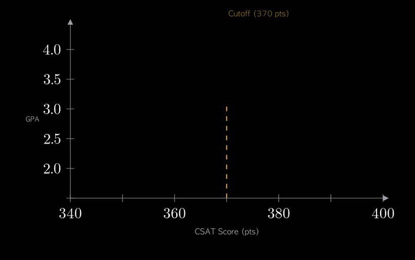

<h1 align="center">Causal Studio</h1>

<p align="center"><strong>어려운 개념을 이해하기 쉬운 영상으로.</strong></p>

<p align="center">Causal Studio의 인과추론 영상을 만드는 오픈소스 Manim 스킬입니다.<br>Claude Code나 Codex에 주제, 원고, 노트북 중 하나를 주고 영상을 만들어 보세요.</p>

<p align="center">
  <a href="#첫-영상-만들기"><strong>영상 만들기</strong></a> ·
  <a href="https://www.youtube.com/@CausalStudio">YouTube에서 보기</a> ·
  <a href="https://causalinferencelab.github.io/causal-studio/">인과추론 교재</a> ·
  <a href="./README.md">English</a>
</p>

<p align="center">
  <a href="https://www.youtube.com/watch?v=65C9J1yJwhc">
    <picture>
      <source media="(prefers-reduced-motion: reduce)" srcset="./docs/assets/rdd-preview.jpg">
      
    </picture>
  </a><br>
  <sub><a href="https://www.youtube.com/watch?v=65C9J1yJwhc">예시 영상 보기</a> · 회귀불연속설계</sub>
</p>

## 첫 영상 만들기

**Manim 스킬을 클론하세요.** 어떤 주제로든 시작할 수 있습니다.

```bash
git clone -b skill-only https://github.com/CausalInferenceLab/causal-studio
```

**`causal-studio` 폴더를 Claude Code나 Codex에서 열고** 아래 요청을 붙여넣으세요.

```text
manim-video-pipeline 스킬로 중학생에게 광합성을 설명해줘. 첫 장면에서
잎에 빛이 닿는 모습을 보여주고, 자막은 그림 아래에 배치해줘. 영상 환경도
준비해서 음성 없는 MP4 미리보기를 보여줘.
```

미리보기를 보고 바꾸고 싶은 부분을 말해 주세요. 주제 한 줄이면 시작할 수 있고, Markdown·텍스트·Jupyter 노트북이 있다면 파일 경로를 알려주면 됩니다.

## 스킬이 하는 일

| 단계 | 결과물 |
| --- | --- |
| 장면 구성 | 내레이션이 나오는 순간과 화면에서 일어날 변화를 연결한 장면 계획 |
| 애니메이션 | 수정 가능한 Manim 코드와 무음 MP4 미리보기. 자막은 그래프와 도형 아래에 배치 |
| 음성 추가 | OpenAI 또는 ElevenLabs 음성과 `*.timings.json`. 실제 음성 길이를 기준으로 애니메이션 타이밍 조정 |

음성 API 키는 내레이션을 추가할 때 필요합니다. [`.env.example`](./.env.example)과 [음성 설정 가이드](./docs/manim-starter.md#3-review-and-add-narration-if-you-want-it)를 참고하세요.

## Causal Studio 둘러보기

애니메이션과 실행 가능한 노트북으로 인과추론을 공부할 수 있습니다. 교재, 노트북, 기존 영상의 Manim 코드를 수정하려면 전체 프로젝트를 클론하세요. 같은 영상 스킬이 들어 있습니다.

```bash
git clone https://github.com/CausalInferenceLab/causal-studio
```

[YouTube에서 강의 보기](https://www.youtube.com/@CausalStudio) · [인과추론 교재](https://causalinferencelab.github.io/causal-studio/) · [스킬 보기](./.claude/skills/manim-video-pipeline/SKILL.md) · [기여하기](./CONTRIBUTING-ko_kr.md)

---

스킬이 영상 제작에 도움이 됐다면 Causal Studio에 스타를 눌러주세요.

MIT. 3Blue1Brown 레퍼런스와 Tabler Icons 같은 외부 자산은 각자의 라이선스를 따릅니다.
