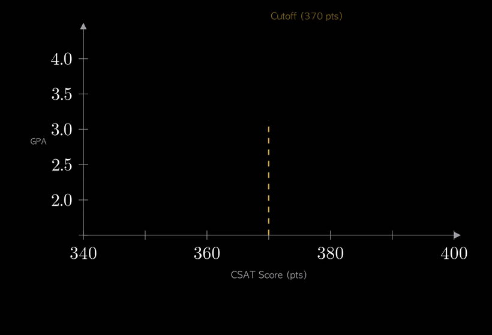
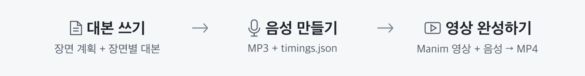

<h1 align="center">Causal Studio</h1>

<p align="center"><strong>어려운 수학·통계 개념을 3Blue1Brown 스타일의 영상으로 만들어 보세요.</strong></p>

<p align="center">인과추론 강의 영상을 만들며 다듬은 오픈소스 Manim 스킬입니다.<br>Claude Code나 Codex에 만들고 싶은 영상을 설명해 주세요.</p>

<p align="center">
  <a href="#첫-영상-만들기"><strong>영상 만들기</strong></a> ·
  <a href="https://www.youtube.com/@CausalStudio">YouTube에서 보기</a> ·
  <a href="https://causalinferencelab.github.io/causal-studio/">인과추론 교재</a> ·
  <a href="./README.md">English</a>
</p>

<p align="center">
  <a href="https://www.youtube.com/watch?v=65C9J1yJwhc">
    <picture>
      <source media="(prefers-reduced-motion: reduce)" srcset="./docs/assets/rdd-preview.jpg">
      
    </picture>
  </a><br>
  <sub><a href="https://www.youtube.com/watch?v=65C9J1yJwhc">예시 영상 보기</a> · 회귀불연속설계</sub>
</p>

## 첫 영상 만들기

1. 영상 제작 도구가 들어 있는 `skill-only` 브랜치를 받으세요.

   ```bash
   git clone -b skill-only https://github.com/CausalInferenceLab/causal-studio
   ```

2. Claude Code나 Codex에서 받은 `causal-studio` 폴더를 열고 이렇게 요청하세요.

   ```text
   manim-video-pipeline으로 1분 15초짜리 A/B 테스트 입문 영상을 만들어줘.
   버튼 색을 바꾼 사례로 전후 비교의 함정, 무작위 배정, 클릭률 차이,
   신뢰구간 해석, 새 버튼의 적용 기준을 다섯 장면으로 설명해줘.
   ```

영상에 반영할 대본이나 Jupyter Notebook이 있다면 파일 경로를 함께 알려주세요. 설명과 그래프를 정리해 둔 노트북을 바탕으로 영상의 순서와 화면을 잡을 수 있습니다. [RDD 노트북 예시](./book/rdd/01_rdd_basic_ko.ipynb)

음성 API 키 없이도 핵심 장면의 미리보기를 만들 수 있습니다.

## 영상 제작 흐름



1. **장면을 설계하고 대본을 씁니다.** 스킬이 주제와 비슷한 3Blue1Brown 영상과 Manim 코드를 찾아 참고할 연출을 고릅니다. 장면마다 무엇을 보여줄지 정하고 대본을 씁니다. 대본은 직접 고치거나 AI에 수정을 요청할 수 있습니다.
2. **내레이션을 추가합니다.** 음성을 원하면 OpenAI나 ElevenLabs로 장면별 MP3를 만들고, 문단별 시작과 종료 시간을 `*.timings.json`에 기록합니다. [환경 변수 예시](./.env.example) · [음성 설정 가이드](./docs/manim-starter.md#3-review-and-add-narration-if-you-want-it)
3. **Manim으로 구현하고 MP4로 완성합니다.** Manim 코드로 장면을 만들고, 렌더링 결과를 보며 구도와 움직임을 다듬습니다. 내레이션이 있으면 화면을 음성에 맞춥니다. 완성한 장면을 한 편의 MP4로 합칩니다.

## 결과물과 장면 수정

장면마다 대본과 Manim 코드가 따로 저장됩니다. A/B 테스트 영상을 만들면 다음과 같은 구조로 정리할 수 있습니다.

```text
videos/ab-test/
├── project.toml           # 참고 자료와 기본 렌더 장면
├── lesson.md              # 주제 한 줄로 시작할 때 만드는 제작 메모
├── scene_plan.md          # 참고 장면과 영상 구성
├── assets/                # 영상에 쓰는 아이콘과 이미지
├── narration/             # 장면별 대본
│   ├── 01_question.txt
│   ├── 02_assignment.txt
│   ├── 03_rates.txt
│   ├── 04_interval.txt
│   └── 05_decision.txt
├── scenes/                # 장면별 Manim 코드
│   ├── scene_01.py
│   ├── scene_02.py
│   ├── scene_03.py
│   ├── scene_04.py
│   ├── scene_05.py
│   └── style.py           # 공통 색상과 그래픽
└── build/
    ├── audio/             # 장면별 MP3와 타이밍
    ├── manim/             # Manim 렌더
    ├── final/             # 음성을 붙인 장면별 MP4
    ├── ab-test.mp4        # 전체 영상
    └── ab-test.ko.srt     # 선택 자막
```

수정하고 싶은 장면의 번호와 바꿀 내용을 Claude Code나 Codex에 알려주세요.

> 3번 장면에서 두 막대의 클릭률 차이를 조금 더 오래 보여줘. 그 장면만 다시 렌더링해줘.

## Causal Studio 둘러보기

강의 영상의 대본과 코드는 RDD [한국어 프로젝트](./videos/rdd/ko/)와 [영어 프로젝트](./videos/rdd/en/)에서 볼 수 있습니다. 교재나 기존 영상도 작업하려면 같은 영상 스킬이 들어 있는 전체 저장소를 받으세요.

```bash
git clone https://github.com/CausalInferenceLab/causal-studio
```

[스킬 보기](./.claude/skills/manim-video-pipeline/SKILL.md) · [기여하기](./CONTRIBUTING-ko_kr.md)

---

스킬이 영상 제작에 도움이 됐다면 Causal Studio에 스타를 눌러주세요.

MIT. 3Blue1Brown 레퍼런스와 Tabler Icons 같은 외부 자산은 각자의 라이선스를 따릅니다.
