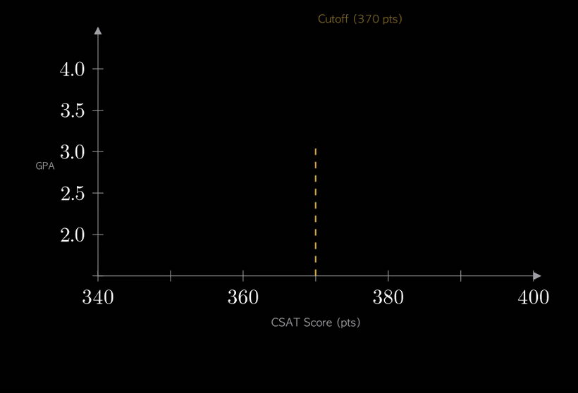

<h1 align="center">Causal Studio</h1>

<p align="center"><strong>Turn challenging concepts in math and statistics into 3Blue1Brown-inspired videos.</strong></p>

<p align="center">The open-source Manim skill behind Causal Studio’s causal inference series.<br>Start with one prompt in Claude Code or Codex.</p>

<p align="center">
  <a href="#make-your-first-video"><strong>Make a video</strong></a> ·
  <a href="https://www.youtube.com/@CausalStudio">Watch on YouTube</a> ·
  <a href="https://causalinferencelab.github.io/causal-studio/">Read the book</a> ·
  <a href="./README-ko_kr.md">한국어</a>
</p>

<p align="center">
  <a href="https://www.youtube.com/watch?v=Rpd3k6Boftk">
    <picture>
      <source media="(prefers-reduced-motion: reduce)" srcset="./docs/assets/rdd-preview.jpg">
      
    </picture>
  </a><br>
  <sub><a href="https://www.youtube.com/watch?v=Rpd3k6Boftk">Watch the example</a> · Regression discontinuity</sub>
</p>

## Make your first video

1. Run this command in your terminal.

   ```bash
   git clone -b skill-only https://github.com/CausalInferenceLab/causal-studio
   ```

2. Open the `causal-studio` folder in Claude Code or Codex and send this prompt.

   ```text
   Use manim-video-pipeline to make a 75-second introduction to A/B testing.
   In five scenes, use a button color experiment to show why a before-and-after comparison
   can mislead, how to assign visitors at random, how to compare click rates, what the
   confidence interval tells us, and how to decide whether to switch.
   ```

If the video should draw on a file, such as a script or a Jupyter Notebook, include its path in your request. You can make a preview without a voice API key.

To guide the explanation and visuals, outline the lesson and include the plotting code in an `.ipynb` first. Causal Studio uses this approach for its causal inference videos. [Example RDD notebook](./book/rdd/01_rdd_basic_en.ipynb)

## From script to narrated video


1. **Write the script.** Edit the agent’s draft yourself or ask for revisions. The revised script guides the narration and what appears on screen.
2. **Generate narration.** OpenAI or ElevenLabs reads the script. Each scene gets an MP3 and a `*.timings.json` file with the start and end of each paragraph.
3. **Animate and assemble.** Time the animation to the narration, keep the numbers and labels viewers need, then join the scenes into one MP4.

For narration, see [`.env.example`](./.env.example) and the [voice setup guide](./docs/manim-starter.md#3-review-and-add-narration-if-you-want-it).

## Example project folder

Each scene has its own script and Manim file. Ask Claude Code or Codex to work on a specific scene when you want to revise it.

> In scene 3, hold the click-rate comparison a little longer and render that scene again.

```text
videos/ab-test/
├── project.toml           # Lesson source and default scene
├── lesson.md              # Created from a topic prompt (.md, .txt, or .ipynb also accepted)
├── scene_plan.md          # What changes on screen in each scene
├── assets/                # Icons and other visual assets, if used
├── narration/
│   ├── 01_question.txt
│   ├── 02_assignment.txt
│   ├── 03_rates.txt
│   ├── 04_interval.txt
│   └── 05_decision.txt
├── scenes/
│   ├── scene_01.py
│   ├── scene_02.py
│   ├── scene_03.py
│   ├── scene_04.py
│   ├── scene_05.py
│   └── style.py           # Shared colors and graphics
└── build/
    ├── audio/             # Scene MP3s and timing files
    ├── manim/             # Manim renders
    ├── final/             # Individual scenes with audio
    ├── ab-test.mp4        # Complete video
    └── ab-test.ko.srt     # Optional subtitles
```

## Explore Causal Studio

Study causal inference with animated lessons and runnable notebooks. Clone the full project to work on the book, notebooks, or original Manim scenes. It includes the same video skill.

```bash
git clone https://github.com/CausalInferenceLab/causal-studio
```

Browse the [RDD scene files](./videos/rdd_en/scenes/) to see how the course organizes its Manim code.

[Watch the lessons on YouTube](https://www.youtube.com/@CausalStudio) · [Read the book](https://causalinferencelab.github.io/causal-studio/) · [View the skill](./.claude/skills/manim-video-pipeline/SKILL.md) · [Contribute](./CONTRIBUTING.md)

---

If the skill helps you make a video, give Causal Studio a star.

MIT. External assets such as the 3Blue1Brown references and Tabler Icons retain their upstream licenses.
