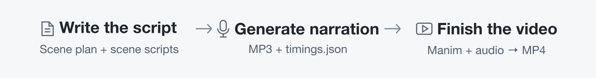

# Manim video pipeline

**Turn challenging concepts in math and statistics into 3Blue1Brown-inspired videos.** This open-source Manim skill was developed for Causal Studio’s causal inference series. Describe the video you want to make in Claude Code or Codex.

[Watch on YouTube](https://www.youtube.com/@CausalStudio) · [Read the Causal Studio book](https://causalinferencelab.github.io/causal-studio/)

## Make your first video

1. Clone the `skill-only` branch to get the video tools.

   ```bash
   git clone -b skill-only https://github.com/CausalInferenceLab/causal-studio
   ```

2. Open the `causal-studio` folder in Claude Code or Codex and try this prompt.

   ```text
   Use manim-video-pipeline to make a 75-second introduction to A/B testing.
   In five scenes, use a button color experiment to show why a before-and-after comparison
   can mislead, how to assign visitors at random, how to compare click rates, what the
   confidence interval tells us, and how to decide whether to switch.
   ```

If you have a script or Jupyter notebook, include its path in your prompt. A notebook with explanations and plots can guide what appears on screen and in what order. [Example RDD notebook](https://github.com/CausalInferenceLab/causal-studio/blob/main/book/rdd/01_rdd_basic_en.ipynb)

You can preview a key scene without a voice API key.

## How the video comes together



1. **Plan the scenes and draft the script.** The skill finds relevant 3Blue1Brown scenes and their Manim code to decide what each scene should show and how to present it. Edit the draft or ask the agent to revise it.
2. **Add narration.** If you want a voice, the agent generates an MP3 for each scene with OpenAI or ElevenLabs and records paragraph timing in `*.timings.json`. Copy `.env.example` to `.env` for first-time setup, then fill in your provider’s settings and name the provider in your request.
3. **Animate in Manim and render the MP4.** The agent writes the Manim code and refines the framing and motion after reviewing the renders. It syncs any narration and joins the scenes into one MP4.

## Files and scene revisions

Each scene has its own script and Manim file. An A/B testing video can be organized like this.

```text
videos/ab_test/en/
├── project.toml           # Lesson source and default scene
├── lesson.md              # Lesson notes created when you start with a topic
├── scene_plan.md          # Visual references and storyboard
├── assets/                # Icons and other visual assets, if used
├── narration/
│   ├── 01_question.txt
│   ├── 02_assignment.txt
│   ├── 03_rates.txt
│   ├── 04_interval.txt
│   └── 05_decision.txt
├── scenes/
│   ├── scene_01_question.py
│   ├── scene_02_assignment.py
│   ├── scene_03_rates.py
│   ├── scene_04_interval.py
│   └── scene_05_decision.py
└── build/
    ├── audio/             # Scene MP3s and timing files
    ├── manim/             # Manim renders
    └── final/             # Individual scenes with audio
        ├── ab_test.mp4        # Complete video
        └── ab_test.ko.srt     # Optional subtitles
```

To revise a scene, tell Claude Code or Codex its number and what to change.

> In scene 3, hold the click-rate comparison a little longer and render that scene again.

[View the skill](https://github.com/CausalInferenceLab/causal-studio/blob/skill-only/.claude/skills/manim-video-pipeline/SKILL.md) · [Voice setup guide](https://github.com/CausalInferenceLab/causal-studio/blob/main/docs/manim-starter.md#3-review-and-add-narration-if-you-want-it) · [Explore the full Causal Studio project](https://github.com/CausalInferenceLab/causal-studio)
