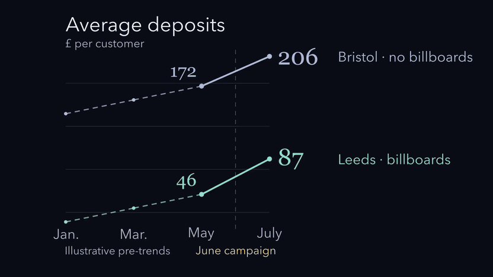

<h1 align="center">Causal Studio</h1>

<p align="center"><strong>Turn challenging concepts in math and statistics into 3Blue1Brown-inspired videos.</strong></p>

<p align="center">An open-source Manim skill developed for Causal Studio’s causal inference series.<br>Describe the video you want to make in Claude Code or Codex.</p>

<p align="center">
  <a href="#make-your-first-video"><strong>Make a video</strong></a> ·
  <a href="https://www.youtube.com/@CausalStudio">Watch on YouTube</a> ·
  <a href="https://causalinferencelab.github.io/causal-studio/">Read the book</a> ·
  <a href="./README-ko_kr.md">한국어</a>
</p>

<p align="center">
  <picture>
    <source media="(prefers-reduced-motion: reduce)" srcset="./docs/assets/did-preview.jpg">
    
  </picture><br>
  <sub>Difference-in-differences · Billboard campaign example</sub>
</p>

## Make your first video

1. Clone the `skill-only` branch.

   ```bash
   git clone -b skill-only https://github.com/CausalInferenceLab/causal-studio
   ```

2. Open the folder in Claude Code or Codex and ask for a video.

   ```text
   Use manim-video-pipeline to explain why A/B tests randomize in a 45-second video.
   Show two ticket checkouts that start with different mixes of shoppers ready to buy.
   Use three scenes to show the initial result, a coin flip for each shopper,
   and the comparison after assignment.
   ```

If you have a script or a Jupyter notebook with explanations and plots, give the agent its path. A topic alone is enough to start. [Example notebook](./book/rdd/01_rdd_basic_en.ipynb)

You can render the first preview without a voice API key.

## How the video comes together

1. **Plan the explanation.** The agent studies a relevant 3Blue1Brown passage and its Manim code, drafts the script, and decides what to follow with the camera and what each move reveals.
2. **Preview the key transition.** Review frames before, during, and after the move. Ask the agent to fix any clipping, overlap, or confusing motion and render that scene again.
3. **Add a voice and finish.** OpenAI or ElevenLabs turns the script into narration. The agent uses `*.timings.json` to sync the final animation and delivers an MP4, thumbnail, and SRT when there is narration. [Voice setup](./docs/manim-starter.md#3-review-and-add-narration-if-you-want-it)

You can ask the agent to split reference research, design, and a first-view review among agents when your tool supports delegation.

## Files and scene revisions

Each scene has its own Manim file and, when narrated, a script.

```text
videos/ab_test/en/
├── project.toml              # Source and default scene
├── lesson.md                 # Brief when you start from a topic
├── scene_plan.md             # References, framing, and storyboard
├── narration/                # Scene scripts
│   ├── 01_question.txt
│   ├── 02_assignment.txt
│   └── 03_comparison.txt
├── scenes/                   # Manim files
│   ├── scene_01_question.py
│   ├── scene_02_assignment.py
│   └── scene_03_comparison.py
└── build/
    ├── audio/                # MP3s and timing files
    ├── logs/                 # One log per render attempt
    ├── manim/                # Rendered scenes
    ├── review/               # Transition frames and contact sheets
    └── final/                # MP4, thumbnail PNG, and optional SRT
```

> In scene 2, leave the first group in view while the assignment changes. Render that scene again.

## Explore Causal Studio

See the [English](./videos/rdd/en/) and [Korean](./videos/rdd/ko/) RDD projects for examples of the scene code and scripts used in the course. To work on the book or existing videos, clone the full repository, which includes the same skill.

```bash
git clone https://github.com/CausalInferenceLab/causal-studio
```

[View the skill](./.claude/skills/manim-video-pipeline/SKILL.md) · [Contribute](./CONTRIBUTING.md)

---

If the skill helps you make a video, give Causal Studio a star.

MIT. External assets such as the 3Blue1Brown references and Tabler Icons retain their upstream licenses.
