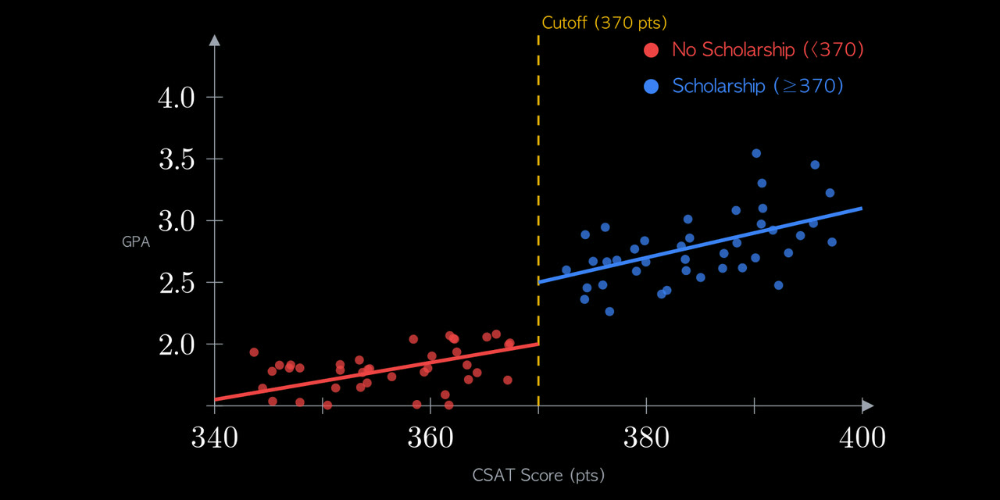

# Causal Studio

[한국어](./README-ko_kr.md)

**Make an animated Manim explainer from an idea, a lesson, or a notebook with Claude Code or Codex.**

Causal Studio pairs animated causal inference lessons with runnable notebooks and shares the skill used to make the videos.

**[Make your first video](#make-your-first-video)** · [Watch the videos](https://www.youtube.com/@CausalStudio) · [Open the book](https://causalinferencelab.github.io/causal-studio/)

[](https://www.youtube.com/watch?v=Rpd3k6Boftk)

## Make your first video

1. Clone Causal Studio.

   ```bash
   git clone https://github.com/CausalInferenceLab/causal-studio.git
   ```

2. Open the cloned folder in Claude Code or Codex and paste this prompt.

   ```text
   Use the manim-video-pipeline skill to make the first scene of a middle-school
   explainer on photosynthesis. Set up the video environment if needed and show
   me a silent MP4 preview.
   ```

3. Watch the preview and tell the agent what to change. For example, ask it to keep the caption on screen longer.

For your own video, give the agent a topic or the path to your Markdown, text, or `.ipynb` file. The silent preview works without a text-to-speech API key. [More prompts and narration options](./docs/manim-starter.md)

<details>
<summary>Clone the Manim skill only</summary>

```bash
git clone -b skill-only https://github.com/CausalInferenceLab/causal-studio
```

Open the cloned folder in Claude Code or Codex and use the same prompt.

</details>

---

[Contributing and full setup](./CONTRIBUTING.md) · [Manim skill](./.claude/skills/manim-video-pipeline/SKILL.md)

If Causal Studio helps you make a video, consider giving it a star.

MIT. External assets (3Blue1Brown references and Tabler Icons) retain their upstream licenses.
