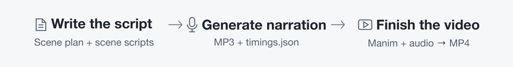

# Make a Manim video with an AI agent



## 1. Clone Causal Studio and open it in your agent

```bash
git clone https://github.com/CausalInferenceLab/causal-studio.git
cd causal-studio
```

Open this folder in Claude Code or Codex. If you already have a checkout or unpacked a Causal Studio starter archive, open that folder.

## 2. Start with a request

Copy this prompt to try the included demo.

> Use `manim-video-pipeline` to render the binary search example. Set up the video environment if it is missing and open or link the resulting MP4.

Or start with your own topic.

> Use `manim-video-pipeline` to make a 75-second introduction to A/B testing. In five scenes, use a button color experiment to show why a before-and-after comparison can mislead, how to assign visitors at random, how to compare click rates, what the confidence interval tells us, and how to decide whether to switch.

If you have a script or Jupyter notebook, include its path in your prompt. A notebook with explanations and plots can guide what appears on screen and in what order. [Example RDD notebook](https://github.com/CausalInferenceLab/causal-studio/blob/main/book/rdd/01_rdd_basic_en.ipynb)

## 3. Review and add narration if you want it

The skill finds relevant 3Blue1Brown scenes and their Manim code to plan what to show in `scene_plan.md`. The agent then writes Manim code for a key scene and renders a silent preview to refine its framing and motion. Each scene has its own script and Manim file, so you can ask for changes by scene number.

> In scene 3, hold the click-rate comparison a little longer and render that scene again.

Edit the draft script yourself or ask the agent to revise it. The revised script guides the narration and what appears on screen. To add a voice, the agent turns the script into an MP3 and records when each passage is spoken in `*.timings.json`. It uses those times to line up the graphics with the narration, then saves them together in the final MP4.

> Add ElevenLabs narration, review the key transitions, and export the finished MP4, thumbnail, and SRT. Make the script one paragraph per visual beat and use the measured timings to align the animation.

If you’re setting up narration for the first time, copy `.env.example` to `.env` in the repository root. For ElevenLabs, fill in `ELEVENLABS_API_KEY` and `ELEVENLABS_VOICE_ID`. For OpenAI, fill in `OPENAI_API_KEY` and ask for OpenAI narration. The agent can render a silent preview before you set up narration.

The [Causal Studio repository](https://github.com/CausalInferenceLab/causal-studio) includes the original videos and notebooks. To revise one, name the topic, language, and scene, such as scene 2 in `videos/rdd/en`.
